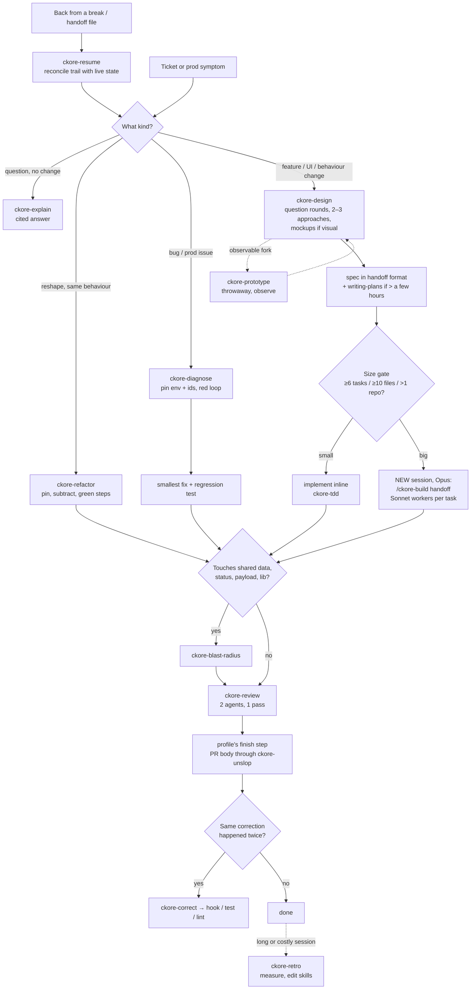

# Workflow

## The flow



## The first prompt for a ticket or bug

`ckore-design` and `ckore-diagnose` ask for the end state and "done when" in their first round, but the session is
cheapest when the first prompt already has them. One ticket spent ~$12–13 of a $23.31 session on a design
that shrank to a +29/−1 fix once the root-cause hint arrived (2026-10-12, L4).

```
<ticket + a concrete example>.
Expected end state: <exact fields / status>.
My hypothesis: <what I think is wrong, even if unsure>.
Constraint: smallest fix first; ask before adding queues, locks or new jobs.
Done when: a test that fails today passes, and the PR touches only the files the fix needs.
```

## Which skill when

| Moment | Use |
|---|---|
| New to the repo, or unsure which skill fits | `/ckore-guide` or `/ckore-guide <skill>` |
| Starting the day, back from a break, or opening a handoff file | `/ckore-resume` |
| "How does X work", "why is it like this", "where should this live" | `ckore-explain` |
| Something is broken or failing | `ckore-diagnose` |
| Start of any feature or behaviour change, backend or UI | `ckore-design` (offers browser mockups for visual questions) |
| A design question you could answer by looking or running | `ckore-prototype` (from inside `ckore-design`) |
| Rename, extract, dedupe, replace an internal API, no new behaviour | `ckore-refactor` |
| More than a few hours of work | The plan step inside `ckore-design` (`ckore-design/PLAN.md`), then the size gate |
| Small feature | Implement inline in the same session with `ckore-tdd` |
| Big feature (the size gate said so) | New Opus session: `/ckore-build <handoff>` |
| Phase boundary, the context is past ~250k tokens, or you're back after more than an hour | `/ckore-handoff`, then `/ckore-resume` in a new session |
| Diff touches data, statuses, payloads or libs others read | `/ckore-blast-radius` |
| Before the PR | `ckore-review` |
| PR body, commit, proposal, CLAUDE.md text | `ckore-unslop` |
| The same correction a second time | `/ckore-correct` |
| Once a week, or after a session over ~$50 (from a fresh session) | `/ckore-retro` (trend), or `/ckore-retro <session id>` |
| A repo's sessions start over ~60k tokens, or after adding plugins or connectors | `/ckore-context-trim` |
| The disk is filling up, or a batch or worktree failed for lack of space | `/ckore-clean-worktrees` |

## Implementation: inline or subagents?

Measured on 33 implementation sessions (correlation only):

| | Sessions | Median cost per session | Median cost per edit | Median compactions |
|---|---|---|---|---|
| Subagent-driven, 3 agents per task | 10 | $89 | $1.67 | 2 |
| Inline or mixed | 23 | $35 | $1.35 | 0 |

- The best subagent runs cost about $0.55 per edit, with Sonnet implementers and a light Opus main thread.
- About 90% of the per-task reviews only confirmed.

Hence the size gate:
- **Small** features are built inline.
- **Big** ones go to `ckore-build`: an Opus orchestrator and Sonnet workers, one per task, with no reviewer per task and one `ckore-review` at the end.

## Profiles

Every project-specific fact lives in `~/.claude/profiles/<name>.md`: environments, prod data access, base branch, commit format, sibling repos, risky areas and repo skills. The skills read the profile whose "Applies to" matches the current repo. Start a new one from `profiles/TEMPLATE.md`.
